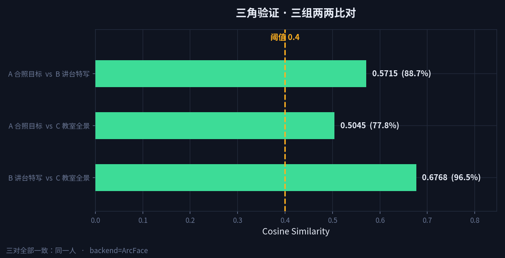

<div align="center">

# 🧬 FaceMatch Lab

**Deep face recognition for answering one question: *is this the same person?***

*Detect → Locate → 512-d Embedding → Distance & Cosine Similarity → Verdict → Full-Image Ranking → Triangulated Verification*

[](https://www.python.org/)
[](https://github.com/deepinsight/insightface)
[](LICENSE)

[English](README.md) · [中文](README.zh-CN.md)

</div>

---

## ❓ The Problem

You have **a group photo** and **one photo of the person you're looking for**. You need to know:

> *Is the person I want in this photo actually in this photo?*

Most face-matching demos answer a much easier question — "are these two cropped faces the same person?" — and they usually answer it by returning a single number with no way to tell whether that number means anything.

**FaceMatch Lab is built around the harder version.** It takes the group photo, finds every face in it, ranks them against your reference photo, and tells you not only *who* it found but *how confident* it is and *how unique* the match is.

---

## ✅ What You Get

| | |
|:---|:---|
| 🧍 **Automatic location** | Finds the target among every face in the group — no manual cropping |
| 📊 **A ranked table** | Every face in the group, sorted by similarity, with a verdict for each |
| 🎯 **Uniqueness, not just a score** | Reports the gap between Top-1 and Top-2, so you know if the match is decisive |
| 🔺 **Triangulated verification** | Cross-checks the result against a third photo before trusting it |
| 🧪 **Self-testing built in** | 6 assertions that prove the algorithm still works — not just that the code runs |
| 🔒 **Privacy by architecture** | Reports contain no coordinates, no file paths; your photos never enter git |

---

## 🚀 Try It in 60 Seconds

No data, no setup, no API keys. The repo ships with **NASA public-domain photographs**:

```bash
git clone https://github.com/Erichestein0702/face-match-lab.git
cd face-match-lab

python src/face_compare.py --samples      # main pipeline: locate → compare → rank → report
python src/triangulate.py  --samples       # triangulated verification
python scripts/selftest.py --samples       # 6-assertion end-to-end self-test
```

The scripts install missing dependencies, download models on first run, and
auto-select the best available backend. **Pure CPU — no GPU required.**

<details>
<summary>Prefer to install dependencies yourself?</summary>

```bash
pip install -r requirements.txt
```

> **Python 3.13+**: `insightface` has no prebuilt wheel yet — use
> `pip install insightface --no-build-isolation`. If that fails, the project
> **automatically falls back** to OpenCV Zoo (YuNet + SFace) with full functionality.
</details>

---

## 📸 What It Looks Like

### Real-world validation

A 17-person group photo plus two photos of the same individual under very
different conditions (indoor half-body shot / outdoor close-up):

| Check | Result | |
|:---|:---|:---:|
| Face detection | **17** faces found in the group photo | ✅ |
| Main verdict | Top-1 cosine **0.5370** → correct person found | ✅ Same person |
| Uniqueness | Top-1 0.5370 vs Top-2 0.0760 — gap of **0.4610** | ✅ Unambiguous |
| Negative control | Highest score among *everyone else*: **0.0760** — nobody else comes close | ✅ Not a lucky guess |
| Triangulation | 0.5370 / 0.4020 / 0.6663 — all three pairs consistent | ✅ |
| **Reference robustness** | Swap in the outdoor close-up as the reference — **still lands on the same face** | ✅ |

> These photos were used for **local validation only and are not in the repository**
> (they carry identifiable watermarks). Every image shipped in this repo is
> NASA public-domain material.

### Public sample (7-person group photo)

| Metric | Value | |
|:---|---:|:---|
| Euclidean distance | **0.9333** | same person ≤ 1.095 ✅ |
| Cosine similarity | **0.5645 (56.45%)** | threshold 0.40 ✅ |
| Confidence | **87.80%** | logistic mapping, 50% at threshold |
| **Verdict** | **✅ Same person** | — |
| Top-1 − Top-2 gap | **0.3813** | decisive, no borderline jitter |
| Triangulation | 0.5645 / 0.7105 / 0.5650 | all three pairs consistent ✅ |
| **Negative control** | Swap in another astronaut's portrait → Top-1 **switches** (0.4380) | ✅ |

That last row is the one that matters. Swap the reference photo and the Top-1
result **moves to a different person**. The ranking reflects genuine identity
similarity — it isn't just "always give the biggest face a high score", which
is what most face-search demos actually do.




---

## 💡 Why It's Built This Way

### 1. Reproducible conclusions, backed by a negative control

Every number in this README was **produced by running the code**, not written by
hand. The repository ships a self-contained control set with known answers, and
the negative control proves the search is genuinely recognising identity rather
than rewarding whatever face happens to look biggest.

### 2. Two backends, automatic fallback

The primary backend is `insightface` (ArcFace, 512-d). On platforms without a
prebuilt wheel it **degrades automatically** to OpenCV Zoo (YuNet + SFace,
128-d). Each path uses its own library's official threshold — nothing here is
a number someone made up.

### 3. Multi-scale detection — no missed faces in the back row

In a group photo, faces in the back row may be only a few dozen pixels tall.
A single input size will miss them. This project detects at **640** and
**1600** long-edge scales and merges with **IoU < 0.4** greedy NMS, so close-ups
and wide group shots both work.

> ⚠️ SCRFD's anchor stride is 32 — input dimensions must be a multiple of 32,
> or `onnxruntime` throws `Invalid input shape`. `det_sizes()` handles this.

### 4. Locating a person and identifying a person are separate problems

| Type | Strategy | The question it answers |
|:---|:---|:---|
| **Retrieval** | `retrieve` (default) | *"Is this person **in** the photo?"* |
| **Geometric** | `largest` / `front-right` / `white-shirt` / `index:N` | *"Is the person **at this position** the one I'm looking for?"* |

Geometric strategies never look at the reference photo when choosing a face, so
their verdict is **independent evidence** — you can cross-check it against the
retrieval result.

### 5. Privacy is enforced by the architecture, not by a README warning

- JSON reports **never contain** `bbox`, `center`, or `path`. Coordinates plus
  the original photo let anyone map every face in the group to a pixel position.
- `data/` is gitignored end to end — your photos can never enter git history.
- A **six-layer privacy audit** (history blobs / worktree / text patterns /
  report fields / ignore rules / sample fingerprints) runs in CI and fails the build.
- CI also runs the **negative-control assertion**, so the pipeline cannot silently
  degrade while still looking green.

### 6. Results carry confidence *and* uniqueness

- Confidence uses a **logistic mapping centred on the threshold** — a cosine
  exactly at the threshold reads 50%.
- The report also includes **`ranking_margin`** (Top-1 minus Top-2). A large gap
  means the match is decisive and not sitting on a boundary — far more robust
  than looking at one score.

---

## 🧪 Self-Testing

`scripts/selftest.py` turns "it runs" into **an assertable regression test**.
Each check returns PASS / FAIL / SKIP; any FAIL means a non-zero exit code,
so it drops straight into CI.

| ID | Check | Assertion |
|:---|:---|:---|
| T1 | Main verdict | Group retrieval Top-1 is judged "same person" |
| T2 | Uniqueness | Top-1 − Top-2 cosine gap > 0.05 (the match must be decisive) |
| T3 | Negative control | Everyone *else* in the group scores below threshold |
| T4 | Pass count | Exactly **1** face in the group crosses the threshold |
| T5 | Triangulation | A-B / A-C / B-C all agree (needs a third photo) |
| T6 | Reference robustness | Swap the reference photo → **the same face** is found again |

T3 and T4 together rule out two distinct failure modes: a lucky high score, and
everyone scoring high.

```bash
python scripts/selftest.py                          # public sample
python scripts/selftest.py --data-dir data          # your own photos
python scripts/selftest.py --group a.jpg --reference b.jpg --third c.jpg
python scripts/selftest.py --json results/selftest.json
```

T5 / T6 need a third photo; without one they are marked SKIP rather than failed.

---

## 📂 Using Your Own Photos

> 🔒 Facial images are **biometric data**. The project never ships, requests, or
> accepts real face photos. You supply your own, locally, in `data/` — which is
> gitignored and can never enter git history.

```
data/                          # local data directory (gitignored, never committed)
├── group.jpg                 # group photo (multiple people)
├── reference.jpg             # reference photo (single person)
├── third.jpg                 # third angle (optional) — enables triangulation
└── <codename>/               # single-person sample library (optional)
    └── 01.jpg
```

```bash
python scripts/prepare_data.py --template    # scaffold the directory structure (text only)
# place your authorised photos as above
python scripts/prepare_data.py --check       # verify the structure

python src/face_compare.py --data-dir data
python scripts/selftest.py --data-dir data  # run the 6 assertions on your own data
```

No suitable photos? Pull from a public dataset (also lands in `data/`, never committed):

```bash
python scripts/prepare_data.py --dataset lfw --num-identities 10
```

> ⚠️ Public datasets carry their own licences — check the terms before commercial use.

**Also supports http(s) URLs directly** (handy from a phone or Colab):

```bash
python src/face_compare.py "https://example.com/group.jpg" "https://example.com/reference.jpg"
```

---

## ⚙️ How It Works

| Backend | Dim | Cosine threshold | Equivalent Euclidean |
|:---|---:|---:|---:|
| ArcFace `w600k_r50` (primary) | 512 | **≥ 0.40** | ≤ 1.095 |
| SFace / OpenCV Zoo (fallback) | 128 | ≥ 0.363 | ≤ 1.088 |

```
cosine_similarity = 1 - (euclidean_distance² / 2)     # for L2-normalised embeddings

confidence = 100 / (1 + exp(-12 * (cos_sim - threshold)))
```

`cos_sim == threshold` → 50%; the further above, the closer to 100%.

Geometric strategy criteria: lower half `y/H > 0.52` · rightmost by `x` ·
white clothing = shoulder HSV `S < 70` and `V > 140`.

> Full methodology, parameter rationale, and boundary analysis:
> **[docs/METHOD.en.md](docs/METHOD.en.md)** (中文版: [docs/METHOD.md](docs/METHOD.md))

---

## 📁 Project Layout

```
face-match-lab/
├── src/
│   ├── config.py             # centralised paths & environment variables (no third-party deps)
│   ├── face_compare.py       # main pipeline: locate → embed → compare → rank → annotate → JSON
│   ├── triangulate.py        # three-image triangulated verification
│   └── plot_results.py       # visualisation charts generated from the JSON reports
├── scripts/
│   ├── selftest.py           # 6-assertion end-to-end self-test; works on any external data dir
│   ├── prepare_data.py       # data prep: structure check / scaffold / copy samples / fetch datasets
│   ├── make_synthetic_data.py# programmatically drawn cartoon faces (no real people)
│   └── privacy_audit.py      # six-layer privacy audit over history / worktree / text / reports / ignore
├── samples/                  # public sample photos (NASA public domain)
├── data/                     # your local data directory (gitignored, never committed)
├── assets/charts/            # similarity distribution & confidence bars (data-only, no faces)
├── assets/results/           # redacted JSON reports
├── docs/METHOD.en.md         # methodology (中文: docs/METHOD.md)
├── results/                  # runtime artefacts (gitignored)
└── .github/workflows/ci.yml  # CI: syntax → smoke → self-test → leak check → privacy audit
```

---

## 🔒 Privacy & Compliance

**No private photos.** Your photos belong in `data/`; that directory is
gitignored and can never be committed. The only real face images in this
repository are the NASA public-domain samples listed in
[`samples/README.en.md`](samples/README.en.md).

**Redacted reports.** JSON contains no `bbox` / `center` / `path`; chart axes use
anonymous indices and position labels, never pixel coordinates. Coordinates are
*locatable biometric data* — released alongside the original photo, they reveal
where every person stands. Similarity, distance, confidence, and the verdict
already express the algorithm's behaviour completely.

**Ignore-rule backstop.** `.gitignore` excludes all image formats by default and
explicitly re-admits only `samples/` and `assets/charts/`.

**Automated in CI.** The pipeline fails the build if a generated report contains
sensitive fields. `python scripts/privacy_audit.py` runs the same six layers locally.

**Please note.** This project is for technical research and validation. Face
recognition is the processing of biometric data — comply with the law that
applies to you (GDPR in the EU/UK, PIPL in China, and equivalents elsewhere).
Photos you place in `data/` must have the **explicit consent** of the people
captured. Do not use it for unauthorised surveillance, tracking, or identity
verification. When sharing results, share the statistics and charts — not the
original photos.

---

<div align="center">

**[⬆ Back to top](#-facematch-lab)**

Made with ☕ by [Erichestein0702](https://github.com/Erichestein0702)

</div>
