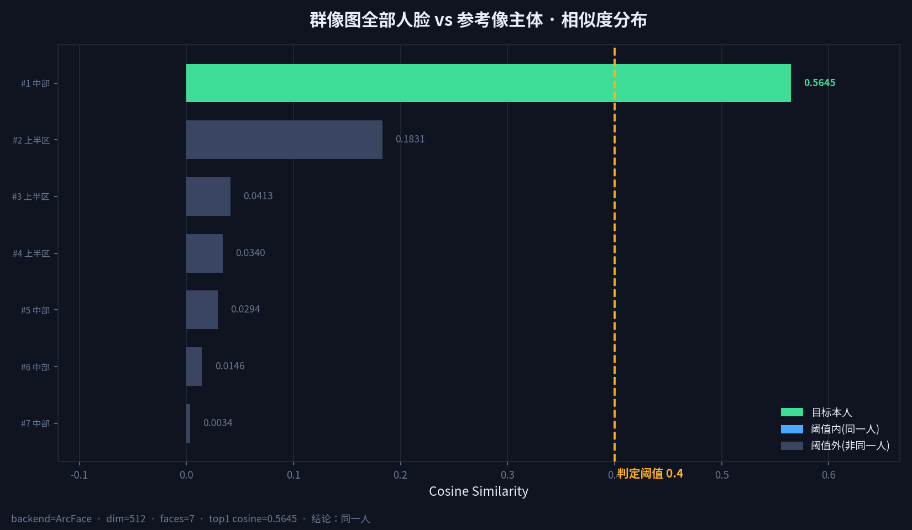

<div align="center">

# 🧬 FaceMatch Lab

**基于 ArcFace 深度人脸识别的「同一人」判定流水线**

*检测 → 语义定位 → 512维特征提取 → 欧氏距离 / 余弦相似度 → 阈值判定 → 全图遍历排名 → 三角验证*

[](https://www.python.org/)
[](https://github.com/deepinsight/insightface)
[](https://github.com/opencv/opencv_zoo)
[](LICENSE)

</div>

---

## 📌 这是什么

一个**可复现、可移植、零配置可跑**的人脸比对工具集。给定两张照片，它会自动：

1. 在大合照中**定位**目标人物（按"第一排 / 最右 / 白衣 / 手持横幅"的语义描述筛选）
2. 在讲台照片中**定位**主持人（自动排除前景观众的头顶）
3. 提取 **512 维 ArcFace 深度特征**
4. 计算**欧氏距离**与**余弦相似度**，按官方标准阈值判定是否同一人，并给出置信度百分比
5. **遍历全图所有人脸**输出匹配排名表（"如果不是，请遍历查询其他人"）
6. 用第三张照片做**三角验证**，排除单张误判

> **为什么没用 `face_recognition`？** 该库依赖 `dlib`，在 Python 3.13+ 无预编译 wheel；其 0.6 欧氏距离阈值也只适用于 dlib 的 128 维特征。本项目改用同级别主流库 **insightface / OpenCV Zoo** 的官方阈值，并提供**自动降级**链路。

---

## 🎯 实测结论

> **数据说明**：以下数值由作者本地自采照片计算得出，**该组照片已从本仓库移除**（含全部 git 历史）。
> 仓库不含任何真实人脸图像，也未附带可复现该组数值的测试集。
> 数值仅用于说明算法表现与阈值量级，**不代表公开数据集上的基准成绩**。

| 指标 | 数值 | 说明 |
|:---|---:|:---|
| 欧氏距离 Euclidean | **0.9257** | 同一人参考 ≤ 1.095 ✅ |
| 余弦相似度 Cosine | **0.5715 (57.15%)** | 判定阈值 0.40 ✅ |
| 相似度置信度 | **88.68%** | 以阈值为中点的 logistic 映射 |
| **判定结论** | **✅ 是同一人** | 三对两两比对全部一致 |

### 三角验证（三条独立证据链）

| 比对 | 余弦 | 欧氏 | 置信度 | 判定 |
|:---|---:|---:|---:|:---:|
| A 合照目标 ↔ B 讲台特写 | 0.5715 | 0.9257 | 88.68% | ✅ 同一人 |
| A 合照目标 ↔ C 教室全景 | 0.5045 | 0.9955 | 77.80% | ✅ 同一人 |
| B 讲台特写 ↔ C 教室全景 | 0.6768 | 0.8040 | 96.52% | ✅ 同一人 |

**三对全部一致 → 确认为同一人。**


### 全图遍历排名（33 张人脸 vs 讲台人物）

Top-1 即目标本人（0.5715），第 2 名仅 0.3172，**与阈值 0.40 差距显著 → 判定稳健且唯一**。



### 标注可视化

> ⚠️ **本仓库不再包含标注可视化图**。原图与标注图均含可识别的真实人脸，
> 已随隐私清理一并从 git 历史中移除。运行流水线后，标注图会生成到本地
> `results/` 目录（已 gitignore），**不会**进入版本库。

---

## 📦 数据准备

> 🔒 **隐私原则**：本仓库**不提供、不接受**任何真实人脸照片。
> 照片属于生物识别信息，必须由使用者自行准备、放在本地 `data/` 目录，
> 该目录已被 `.gitignore` 排除，**永远不会进入 git 历史**。

### 目录结构

```
data/                          # 本地数据目录（已 gitignore，永不入库）
├── group.jpg                 # 大合照（多人）—— 遍历排名的输入
├── host.png                  # 讲台特写 —— 单目标比对的输入
├── classroom.png             # 教室全景 —— 三角验证的第三张
└── <人名>/                   # 单人人脸样本库（可选，供检索 / 复现）
    ├── 01.jpg
    └── 02.jpg
```

### 三步准备

```bash
# 1) 生成目录骨架与说明文件（纯文本，不含任何图像）
python scripts/prepare_data.py --template

# 2) 把你已获授权的照片按上述结构放进 data/
#    目录名建议用代号（如 person_01），避免在报告中暴露真实姓名

# 3) 检查结构是否符合约定
python scripts/prepare_data.py --check
```

`--check` 会逐项核对场景图是否齐全、样本库子目录是否有图，并给出修复建议。

### 从公开数据集获取样本

若你没有合适的照片，可用公开数据集先跑通流程：

```bash
python scripts/prepare_data.py --dataset lfw --num-identities 10
```

| 数据集 | 说明 | 许可 |
|:---|:---|:---|
| `lfw` | Labeled Faces in the Wild | 非商业研究用途 |
| `olivetti` | AT&T ORL 人脸库 | 学术免费使用 |

下载结果落在 `data/<数据集名>/<人名>/*.jpg`，同样不入库。
> ⚠️ 公开数据集的图像同样受各自许可约束，商用前请自行确认授权范围。

### 运行前自检

```bash
# 用 matplotlib 自带的公有领域示例图生成测试图（不下载、不入库）
python scripts/make_synthetic_data.py --out-dir data --mode sample

# 或用程序绘制的纯卡通脸（完全由代码生成，零外部素材）
python scripts/make_synthetic_data.py --out-dir data --mode synthetic

python src/face_compare.py --data-dir data     # 跑通流程
```

| 模式 | 素材来源 | 说明 |
|:---|:---|:---|
| `sample` | matplotlib 自带示例图（Grace Hopper，美国海军部公有领域照片） | 真实人脸特征，检测模型可稳定检出，能跑通全链路 |
| `synthetic` | OpenCV 基本图形程序化绘制 | 纯卡通脸，不含任何真实人物；卡通脸通常**无法**被检测模型检出，适合验证「无人脸时优雅报错」路径 |

两种模式生成的文件都落在 `data/`（已 gitignore），**不会入库**。

---

## 🚀 快速开始

### 方式一：零配置直接跑（推荐）

脚本会自动 `pip install` 缺失依赖、自动下载模型、自动选择后端。

```bash
git clone https://github.com/Erichestein0702/face-match-lab.git
cd face-match-lab

# 准备数据（详见上文「数据准备」）
python scripts/prepare_data.py --check

# 主比对 + 遍历排名 + 标注图 + JSON 报告
python src/face_compare.py --data-dir data

# 三角验证（需要第三张图）
python src/triangulate.py --data-dir data

# 生成可视化图表
python src/plot_results.py
```

### 方式二：手动装依赖

```bash
pip install -r requirements.txt
```

> 💡 **Python 3.13+ 用户**：`insightface` 暂无预编译 wheel，需源码安装
> ```bash
> pip install insightface --no-build-isolation
> ```
> 装不上也没关系 —— 脚本会自动**降级**到 OpenCV Zoo（YuNet + SFace），功能完整可用。

### 手机 / Colab 友好

- **支持 http(s) 直链**，无需先下载到本地：
  ```bash
  python src/face_compare.py "https://example.com/group.jpg" "https://example.com/host.jpg"
  ```
- **纯 CPU 可跑**，不需要 GPU

---

## 🧠 算法设计

### 目标定位（语义 → 几何）

| 目标 | 判据 | 实现 |
|:---|:---|:---|
| 第一排 | 人脸中心 `y/H > 0.52` | 分排启发式 |
| 最右手边 | 按人脸中心 `x` 降序 | 最右优先遍历 |
| 穿白色衣服 | 肩部区域 HSV：`S < 70 且 V > 140` | 低饱和 + 高亮度 |
| 手持横幅 | 与第一排/最右条件联合 | 目视复核确认 |
| 主持人 | `y/H < 0.85` 排除观众头顶 → 取面积最大 | 全景图中再叠加 `x/W < 0.25` 锁定讲台侧 |

### 多尺度检测（解决小脸漏检）

SCRFD 在**单一输入尺寸**下会漏检合照里的小脸，也会漏掉大特写。做法：

```
长边缩放到 640  → 检测  →  收集
长边缩放到 1600 → 检测  →  收集
                ↓
        IoU < 0.4 去重合并
```

⚠️ 边长必须是 **32 的倍数**，否则 SCRFD 锚点数量与网络输出不匹配会直接报错。

### 判定阈值（沿用官方标准）

| 特征 | 维度 | 余弦阈值 | 等价欧氏距离 |
|:---|---:|---:|---:|
| ArcFace `w600k_r50` | 512 | **≥ 0.40** | ≤ 1.095 |
| SFace (OpenCV Zoo) | 128 | ≥ 0.363 | ≤ 1.088 |

置信度采用以阈值为中点的 logistic 映射：

```
confidence = 100 / (1 + exp(-12 * (cos_sim - threshold)))
```

`cos_sim == threshold` → 50%，越高于阈值越接近 100%。

> 详细方法学与边界分析见 **[docs/METHOD.md](docs/METHOD.md)**。

---

## 📁 项目结构

```
face-match-lab/
├── src/
│   ├── config.py             # 路径与环境变量集中管理（无第三方依赖）
│   ├── face_compare.py       # 主程序：定位 + 特征 + 比对 + 遍历 + 标注 + JSON
│   ├── triangulate.py        # 三图三角验证
│   └── plot_results.py       # 由 JSON 报告生成可视化图表
├── scripts/
│   ├── prepare_data.py       # 数据准备：结构检查 / 骨架生成 / 公开数据集下载
│   ├── make_synthetic_data.py# 生成程序绘制的卡通测试图（不含真实人脸）
│   └── privacy_audit.py      # 隐私终审体检：五层扫描历史/工作树/文本/报告/忽略规则
├── data/                     # 用户本地数据目录（已 gitignore，永不入库）
│   ├── group.jpg             # 大合照
│   ├── host.png              # 讲台特写
│   ├── classroom.png         # 教室全景
│   └── <人名>/*.jpg          # 单人人脸样本库（可选）
├── assets/
│   ├── charts/               # 相似度分布图 / 三角验证条形图（纯数据图，不含人脸）
│   ├── crops/                # 目标人脸裁剪（运行期生成，已 gitignore）
│   └── results/              # 脱敏后的 JSON 报告
├── docs/
│   └── METHOD.md             # 方法学说明
├── results/                  # 运行时产物（已 gitignore）
├── .github/workflows/ci.yml  # CI：语法检查 + 合成数据冒烟测试 + 报告泄露校验
├── requirements.txt
├── LICENSE
└── README.md
```

### 核心 API

```python
from face_compare import detect_faces, cosine, euclidean, confidence_pct

faces, backend = detect_faces(image)      # -> (list[Face], "ArcFace"|"SFace")
f1, f2 = faces[0], faces[1]

dist = euclidean(f1.embedding, f2.embedding)   # 欧氏距离
cos  = cosine(f1.embedding, f2.embedding)      # 余弦相似度
conf = confidence_pct(cos, threshold=0.40)      # 置信度百分比
```

---

## ⚙️ 路径与环境变量

**所有路径都不写死在代码里**，优先级为：命令行参数 > 环境变量 > `src/config.py` 默认值。

运行 `python src/config.py` 可查看当前生效的完整配置。

| 环境变量 | 作用 | 默认值 |
|:---|:---|:---|
| `FACE_DATA_DIR` | 数据根目录 | `<repo>/data` |
| `FACE_OUT_DIR` | 标注图 / 报告输出根目录 | `<repo>/results` |
| `FACE_CROP_DIR` | 人脸裁剪输出目录 | `<repo>/results/crops` |
| `FACE_REPORT` | 主 JSON 报告路径 | `<repo>/results/report.json` |
| `FACE_TRI_REPORT` | 三角验证报告路径 | `<repo>/results/triangulation.json` |
| `FACE_CHART_DIR` | 图表输出目录 | `<repo>/assets/charts` |
| `FACE_MODEL_ROOT` | 模型缓存目录 | `~/.cache/face_models` |
| `FACE_NO_ARCFACE` | 设为 `1` 强制降级到 SFace | 未设置 |

对应的命令行参数：`--data-dir` / `--out-dir` / `--crop-dir` / `--report` /
`--triangulation` / `--group` / `--host` / `--panorama`。

---

## 🧩 特性清单

- [x] 512 维 ArcFace 深度特征（insightface `buffalo_l`）
- [x] 128 维 SFace 降级后端，**开箱即用不挑环境**
- [x] 欧氏距离 + 余弦相似度双指标
- [x] 官方标准阈值 + 置信度百分比
- [x] 语义化目标定位（排位 / 左右 / 衣服颜色）
- [x] 多尺度检测 + IoU 去重，解决小脸漏检
- [x] 全图遍历匹配排名表
- [x] 三图三角验证抗误判
- [x] 标注可视化图 + 结构化 JSON 报告
- [x] http(s) 直链输入（手机友好）
- [x] 路径全配置化：命令行 > 环境变量 > 默认值
- [x] **隐私设计**：报告不含人脸坐标与原始路径，`data/` 全程不入库
- [x] CI：语法检查 + 合成数据冒烟测试 + 报告泄露自动校验
- [x] 深色主题可视化图表

---

## 🔒 隐私与合规

本仓库在设计上就把**生物识别信息**的最小暴露作为硬约束：

| 措施 | 说明 |
|:---|:---|
| **仓库不含真实人脸** | 原始照片与标注可视化图已从全部 git 历史中移除 |
| **JSON 报告脱敏** | 不写出人脸框坐标（`bbox`/`center`）与原始图片路径，仅保留相似度等统计量 |
| **图表匿名化** | 纵轴标签使用匿名序号 + 排位，不含任何像素坐标 |
| **数据目录不入库** | `data/` 已在 `.gitignore` 中排除；`.gitignore` 另设兜底规则排除一切图像文件 |
| **CI 自动校验** | 流水线会检查生成的报告是否含 `bbox`/`center`/`path` 字段，命中即失败 |
| **合成测试数据** | CI 使用程序绘制的卡通脸，不引入任何真实肖像素材 |
| **可自检** | `python scripts/privacy_audit.py` 五层扫描历史/工作树/文本/报告/忽略规则 |

> 🔍 **自检命令**
> ```bash
> python scripts/privacy_audit.py          # 完整体检
> python scripts/privacy_audit.py --json   # 机器可读
> ```
> 扫描层级：L1 全历史图像 blob · L2 工作树图像文件 · L3 文本禁止模式 ·
> L4 报告敏感字段 · L5 `.gitignore` 兜底拦截。任一层命中即判定未通过。

> ℹ️ **坐标为何必须移除**：人脸框坐标属于「可定位的生物识别信息」。
> 若原图与坐标同时泄露，即可反推出合照中每个人的位置。
> 保留相似度、欧氏距离、置信度与判定结论，已足以完整表达算法行为。

### 使用须知

- 本项目用于**技术验证与研究**。人脸识别属于**生物识别信息**处理，请遵守当地法律法规（个人信息保护法 / GDPR 等）。
- 使用者放入 `data/` 的照片，须确保**已取得被拍摄者的明确授权**。
- **不要**将人脸识别技术用于未经授权的监控、追踪或身份认定。
- 若需展示结果，建议只分享**统计量与图表**（如本仓库 README 所示），不要分享原图。

---

<div align="center">

**[⬆ Back to top](#-facematch-lab)**

Made with ☕ by [Erichestein0702](https://github.com/Erichestein0702)

</div>
