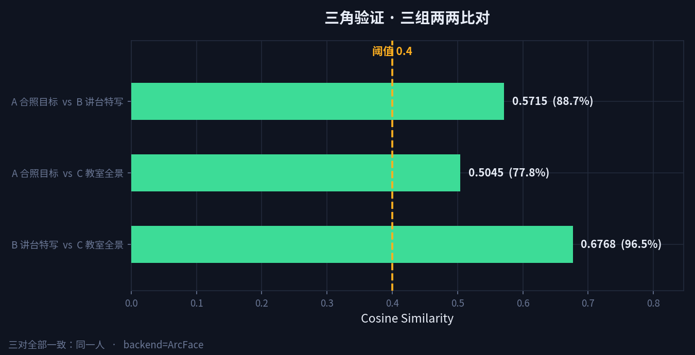
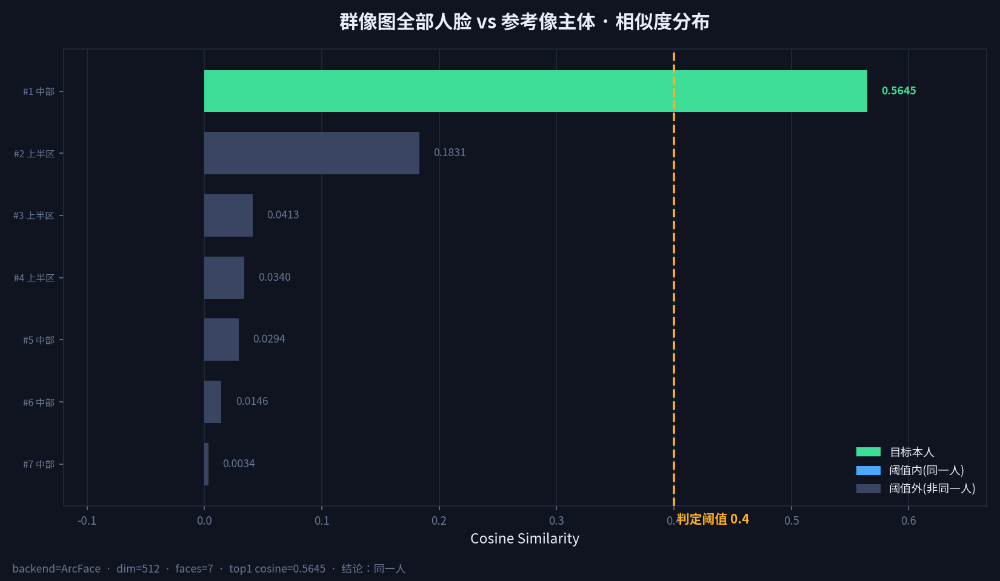

<div align="center">

# 🧬 FaceMatch Lab

**深度人脸识别，只回答一个问题：*这是不是同一个人？***

*检测 → 定位 → 512维特征 → 距离与余弦相似度 → 判定 → 全图遍历排名 → 三角验证*

[](https://www.python.org/)
[](https://github.com/deepinsight/insightface)
[](LICENSE)

[English](README.md) · [中文](README.zh-CN.md)

</div>

---

## ❓ 要解决的问题

你手里有**一张合照**，和**一张你想找的人的照片**。你需要知道：

> *我找的人，到底在不在这张合照里？*

多数人脸比对 Demo 回答的是一个简单得多的问题 —— "这两张裁剪出来的人脸是不是同一个人"，
而且通常只丢给你一个数字，**你无从判断这个数字意味着什么**。

**FaceMatch Lab 做的是难的那个版本。** 它把合照里每张脸都找出来，与你的参考像逐一排名，
不仅告诉你**找到了谁**，还告诉你**有多确信**、**这个匹配有多唯一**。

---

## ✅ 你会得到什么

| | |
|:---|:---|
| 🧍 **自动定位** | 在合照的所有人脸中自动找到目标，无需手动裁剪 |
| 📊 **一张排名表** | 合照中每张脸按相似度排序，每一行都带判定结论 |
| 🎯 **唯一性，而非单一分数** | 给出 Top-1 与 Top-2 的差值，让你知道匹配是否干脆利落 |
| 🔺 **三角验证** | 用第三张照片交叉验证，再决定是否采信 |
| 🧪 **自带自测** | 6 项断言证明算法仍然有效，而不只是"代码能跑" |
| 🔒 **隐私写进架构** | 报告不含坐标、不含路径；你的照片永远进不了 git |

---

## 🚀 60 秒上手

无需准备数据，无需配置，无需 API Key。仓库自带 **NASA 公有领域照片**：

```bash
git clone https://github.com/Erichestein0702/face-match-lab.git
cd face-match-lab

python src/face_compare.py --samples      # 主流程：定位 → 比对 → 排名 → 报告
python src/triangulate.py  --samples       # 三角验证
python scripts/selftest.py --samples       # 6 项断言的端到端自测
```

脚本会自动安装缺失依赖、首次运行自动下载模型、自动选择最优后端。
**纯 CPU 可跑，不需要 GPU。**

<details>
<summary>想手动装依赖？</summary>

```bash
pip install -r requirements.txt
```

> 💡 **Python 3.13+**：`insightface` 暂无预编译 wheel，需
> `pip install insightface --no-build-isolation`。
> 装不上也没关系 —— 项目会**自动降级**到 OpenCV Zoo（YuNet + SFace），功能完整可用。
</details>

---

## 📸 实际效果

### 真实场景验证

一张 17 人大合照 + 同一人的两张照片（室内半身 / 户外特写），拍摄条件差异很大：

| 检查项 | 结果 | |
|:---|:---|:---:|
| 人脸检测 | 合照中检出 **17** 张脸 | ✅ |
| 主判定 | Top-1 余弦 **0.5370** → 命中正确的人 | ✅ 同一人 |
| 唯一性 | Top-1 0.5370 vs Top-2 0.0760，差 **0.4610** | ✅ 无歧义 |
| 负对照 | *其余所有人*中最高仅 **0.0760**，无人接近 | ✅ 不是碰巧撞高 |
| 三角验证 | 0.5370 / 0.4020 / 0.6663 —— 三对全部一致 | ✅ |
| **参考像鲁棒** | 换成户外特写当参考像，**仍命中同一张脸** | ✅ |

> 这组照片仅用于**本地验证，不在仓库中**（带有可识别的水印）。
> 仓库内所有图像均为 NASA 公有领域素材。

### 公开示例（7 人合照）

| 指标 | 数值 | |
|:---|---:|:---|
| 欧氏距离 | **0.9333** | 同一人参考 ≤ 1.095 ✅ |
| 余弦相似度 | **0.5645 (56.45%)** | 阈值 0.40 ✅ |
| 置信度 | **87.80%** | logistic 映射，阈值处为 50% |
| **判定结论** | **✅ 是同一人** | — |
| Top-1 − Top-2 差值 | **0.3813** | 匹配唯一，无边界抖动 |
| 三角验证 | 0.5645 / 0.7105 / 0.5650 | 三对全部一致 ✅ |
| **负对照** | 换成另一位宇航员肖像 → Top-1 **自动切换**（0.4380） | ✅ |

最后一栏才是关键。换掉参考像，Top-1 结果**会跳到另一个人身上**。
这证明排名反映的是**真实的身份相似性**，而不是「永远给最大的那张脸打高分」——
而后者正是多数人脸检索 Demo 的真实行为。





---

## 💡 为什么这样设计

### 1. 结论可复现，且有负对照兜底

本文档里所有数值都是**跑出来的**，不是手写的。仓库内置一组自带答案的公开对照组，
负对照证明检索确实在认人，而不是给"看起来最大"的那张脸发高分。

### 2. 双后端自动降级，不挑环境

主后端 `insightface`（ArcFace 512 维）在部分平台没有预编译 wheel，
此时**自动降级**到 OpenCV Zoo（YuNet + SFace 128 维）。
两条链路各自使用所属库的官方阈值，不是谁拍脑袋抄的。

### 3. 多尺度检测，后排小脸不漏检

合照后排的人脸可能只有几十像素高，单一输入尺寸必然漏检。
本项目在 **640** / **1600** 两档长边分别检测后用 **IoU < 0.4** 贪心 NMS 合并，
特写与大合照同时兼顾。

> ⚠️ SCRFD 的 anchor stride 为 32，输入边长必须为 32 的倍数，否则
> `onnxruntime` 直接抛 `Invalid input shape`。`det_sizes()` 已做修正。

### 4. 「找到人」与「认出人」是两个问题

| 类型 | 策略 | 回答的问题 |
|:---|:---|:---|
| **检索型** | `retrieve`（默认） | 「这个人**在不在**这张照片里？」 |
| **几何型** | `largest` / `front-right` / `white-shirt` / `index:N` | 「**这个位置**的人是不是我要找的人？」 |

几何型策略选人时**完全不看参考像**，因此判定结果具独立意义，可与检索型交叉验证。

### 5. 隐私是架构约束，不是 README 提醒

- JSON 报告**永不包含** `bbox`、`center`、`path`。坐标一旦与原图同时泄露，
  就能把合照里每个人的位置还原出来。
- `data/` 目录全程 gitignore，你的照片**永远不会**进入 git 历史。
- **六层隐私体检**（历史 blob / 工作树 / 文本模式 / 报告字段 / ignore 规则 / 样例指纹）
  在 CI 中执行，命中即失败。
- CI 还跑**负对照断言**，防止算法退化后流水线仍「看起来全绿」。

### 6. 结果同时带置信度与唯一性

- 置信度采用**以阈值为中点的 logistic 映射** —— 余弦正好等于阈值时读作 50%。
- 报告额外给出 **`ranking_margin`**（Top-1 减 Top-2）。差值大说明匹配干脆利落、
  不在判定边界附近 —— 比只看一个分数稳健得多。

---

## 🧪 端到端自测

`scripts/selftest.py` 把「跑得通」变成**可断言的回归测试**。
每项检查返回 PASS / FAIL / SKIP，任一 FAIL 即退出码非 0，可直接接入 CI。

| 编号 | 检查项 | 断言 |
|:---|:---|:---|
| T1 | 主判定 | 群像检索 Top-1 判定为「同一人」 |
| T2 | 唯一性 | Top-1 − Top-2 余弦差 > 0.05（匹配必须唯一） |
| T3 | 负对照 | *其余所有人*的相似度低于阈值 |
| T4 | 过线人数 | 群像中恰好 **1** 张脸过阈值 |
| T5 | 三角验证 | A-B / A-C / B-C 三对两两一致（需第三视角） |
| T6 | 参考像鲁棒 | 换用第三视角作参考像，**命中同一张脸** |

T3 与 T4 组合可排除两类不同的退化：「碰巧撞高」和「全员高分」。

```bash
python scripts/selftest.py                          # 公开示例
python scripts/selftest.py --data-dir data          # 自己的照片
python scripts/selftest.py --group a.jpg --reference b.jpg --third c.jpg
python scripts/selftest.py --json results/selftest.json
```

T5 / T6 需要第三视角，缺失时自动标记 SKIP 而非失败。

---

## 📂 使用你自己的照片

> 🔒 人脸图像属于**生物识别信息**。本项目不提供、不索取、不接受任何真实人脸照片。
> 照片由你自己在本地准备、放进 `data/` —— 该目录已被 gitignore，
> **永远不会进入 git 历史**。

```
data/                          # 本地数据目录（gitignored，永不入库）
├── group.jpg                 # 群像图（多人）
├── reference.jpg             # 参考像（单人）
├── third.jpg                 # 第三视角（可选）—— 启用三角验证
└── <代号>/                   # 单人人脸样本库（可选）
    └── 01.jpg
```

```bash
python scripts/prepare_data.py --template    # 生成目录骨架（纯文本）
# 把已获授权的照片按上述结构放进 data/
python scripts/prepare_data.py --check       # 检查结构是否符合约定

python src/face_compare.py --data-dir data
python scripts/selftest.py --data-dir data  # 用自己的数据跑 6 项断言
```

没有合适的照片？可从公开数据集获取（同样落在 `data/`，不入库）：

```bash
python scripts/prepare_data.py --dataset lfw --num-identities 10
```

> ⚠️ 公开数据集的图像同样受各自许可约束，商用前请自行确认授权范围。

**也支持直接输入 http(s) 链接**（手机 / Colab 场景很方便）：

```bash
python src/face_compare.py "https://example.com/group.jpg" "https://example.com/reference.jpg"
```

---

## ⚙️ 原理速览

| 后端 | 维度 | 余弦阈值 | 等价欧氏距离 |
|:---|---:|---:|---:|
| ArcFace `w600k_r50`（主） | 512 | **≥ 0.40** | ≤ 1.095 |
| SFace / OpenCV Zoo（降级） | 128 | ≥ 0.363 | ≤ 1.088 |

```
cosine_similarity = 1 - (euclidean_distance² / 2)     # 对 L2 归一化向量成立

confidence = 100 / (1 + exp(-12 * (cos_sim - threshold)))
```

`cos_sim == threshold` → 50%；越高于阈值越接近 100%。

几何型策略判据：下半区 `y/H > 0.52` · 最右侧按 `x` 降序 ·
白色衣物为肩部 HSV `S < 70` 且 `V > 140`。

> 完整方法学、参数取值依据与边界分析：
> **[docs/METHOD.md](docs/METHOD.md)**（English: [docs/METHOD.en.md](docs/METHOD.en.md)）

---

## 📁 项目结构

```
face-match-lab/
├── src/
│   ├── config.py             # 路径与环境变量集中管理（无第三方依赖）
│   ├── face_compare.py       # 主程序：定位 + 特征 + 比对 + 遍历 + 标注 + JSON
│   ├── triangulate.py        # 三图三角验证
│   └── plot_results.py       # 由 JSON 报告生成可视化图表
├── scripts/
│   ├── selftest.py           # 6 项断言的端到端自测，支持外部数据目录
│   ├── prepare_data.py       # 数据准备：结构检查 / 骨架生成 / 公开示例复制 / 数据集下载
│   ├── make_synthetic_data.py# 程序绘制的卡通测试图（不含真实人脸）
│   └── privacy_audit.py      # 六层隐私体检：历史/工作树/文本/报告/忽略规则/样例指纹
├── samples/                  # 公开示例（NASA 公有领域照片）
├── data/                     # 你的本地数据目录（gitignored，永不入库）
├── assets/charts/            # 相似度分布图 / 三角验证条形图（纯数据图，不含人脸）
├── assets/results/           # 脱敏后的 JSON 报告
├── docs/METHOD.md            # 方法学说明（English: docs/METHOD.en.md）
├── results/                  # 运行时产物（gitignored）
└── .github/workflows/ci.yml  # CI：语法 → 冒烟 → 自测 → 泄露校验 → 隐私体检
```

---

## 🔒 隐私与合规

**不含私人照片。** 你的照片属于 `data/`，该目录已 gitignore，永不入库。
仓库内唯一的真实人脸图像是 NASA 公有领域素材，清单见
[`samples/README.md`](samples/README.md)。

**报告脱敏。** JSON 不含 `bbox` / `center` / `path`；图表纵轴用匿名序号 + 位置标签，
绝无像素坐标。坐标属于「可定位的生物识别信息」，一旦与原图同时泄露，
即可还原出合照里每个人的位置。而相似度、距离、置信度与判定结论，
已足以完整表达算法的行为。

**ignore 兜底。** `.gitignore` 默认排除一切图像格式，仅显式放行 `samples/` 与 `assets/charts/`。

**CI 自动校验。** 流水线在生成的报告含敏感字段时直接失败；
`python scripts/privacy_audit.py` 可在本地跑同样的六层扫描。

**使用须知。** 本项目用于技术验证与研究。人脸识别属于生物识别信息处理，
请遵守适用于你的法律法规（欧盟/英国 GDPR、中国 PIPL，以及各地对应法规）。
放入 `data/` 的照片须确保已取得被拍摄者的**明确授权**。
不要用于未经授权的监控、追踪或身份认定。展示结果时只分享统计量与图表，不要分享原图。

---

<div align="center">

**[⬆ Back to top](#-facematch-lab)**

Made with ☕ by [Erichestein0702](https://github.com/Erichestein0702)

</div>
